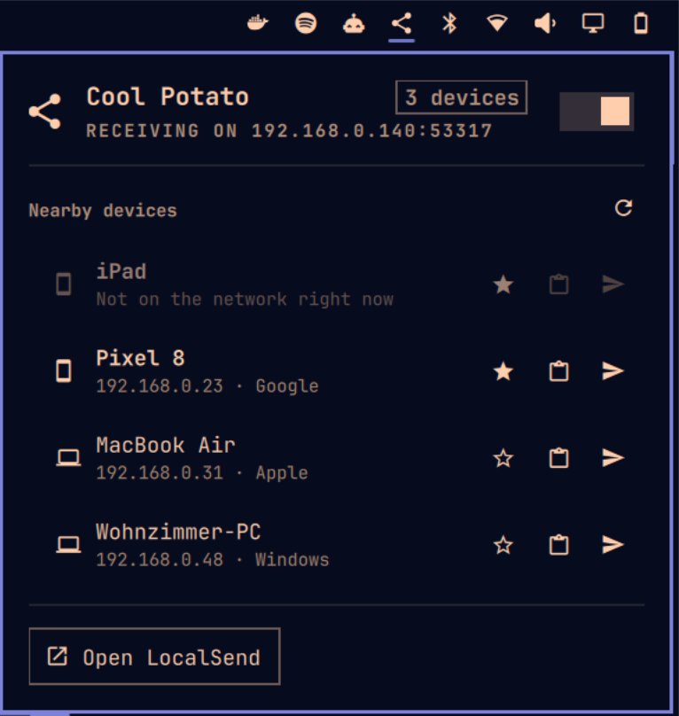
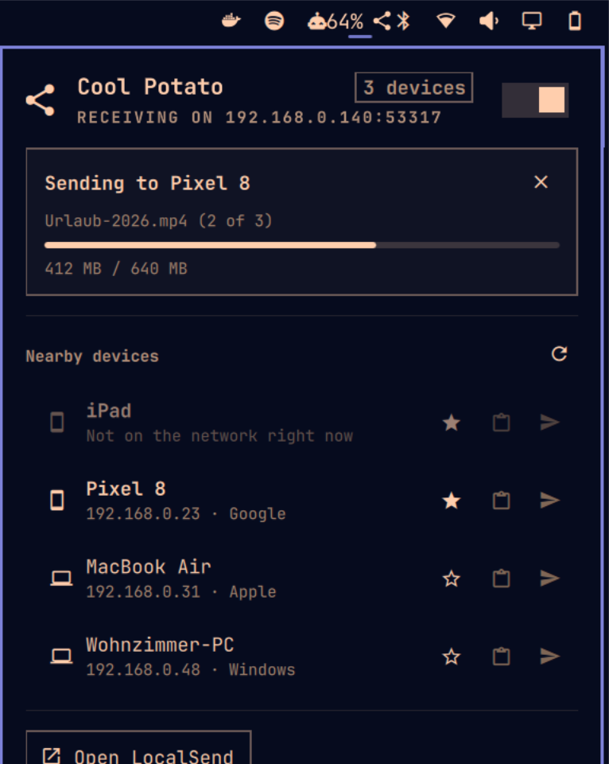

# LocalSend for the Omarchy bar

Send files or the clipboard to phones and computers on your network, right
from the [Omarchy](https://omarchy.org) bar. The plugin speaks the
[LocalSend](https://localsend.org) protocol, so the other side only needs the
regular LocalSend app.

<p align="center">
  
</p>

- Lists the LocalSend devices on your network as they answer.
- Sends files, or the clipboard as text or as a PNG image.
- Keeps favorites, which stay in the list while they are offline.
- Switches this machine's receiver on and off.
- Shows the transfer in the panel and its percentage in the bar.

<p align="center">
  
</p>

## Install

```
omarchy plugin add https://github.com/mae240/omarchy-localsend.git --enable
omarchy restart shell
```

Needs `python3`, `openssl` and the `localsend` app. Omarchy ships all three.
Sending works without the app running. Receiving needs the app, and the
switch in the panel starts it.

## Use

| Where | Action |
|---|---|
| Bar icon, left click | open the panel |
| Bar icon, right click | receiver on or off |
| Bar icon, middle click | scan again |
| Row, paper plane | pick files and send them |
| Row, clipboard | send the clipboard |
| Row, star | keep the device as a favorite |
| Switch at the top | start LocalSend hidden in the tray, or stop it |

Keys inside the panel:

| Key | Action |
|---|---|
| `j` / `k` | move |
| `Enter`, `s` | send files |
| `c` | send the clipboard |
| `f` / `x` | favorite / unfavorite |
| `r` | scan again |
| `t` | receiver on or off |
| `o` | open LocalSend |
| `Esc` | close |

The bar icon is bright while this machine receives and dim while it does not.

## Settings

| Key | Default | Meaning |
|---|---|---|
| `scanIntervalSec` | 20 | how often the panel rescans while it is open |

Change it in the bar settings, or with
`omarchy bar set mae.localsend scanIntervalSec 30 --json`.

## How it works

`bin/localsend-helper.py` speaks LocalSend protocol v2 with the Python
standard library. To find devices it announces itself on the LocalSend
multicast group and, at the same time, asks every host of your /24 network
for its info. Devices that miss the multicast still turn up that way.
Sending goes through `prepare-upload` and `upload`. Clipboard text travels as
a LocalSend text message.

The helper identifies itself with a self-signed certificate that it creates
once in `~/.local/state/mae-localsend/`. LocalSend 2.2 peers require one.

The receiver is the LocalSend app itself, started as the user unit
`mae-localsend-receiver` with `--hidden`. Received files go to the folder the
app saves to. Favorites live in the widget's entry in
`~/.config/omarchy/shell.json`.

## Security

A LocalSend device over https names a fingerprint, and that fingerprint is
the SHA-256 of its TLS certificate. The plugin checks it:

- An https device shows up only after its certificate matched the
  fingerprint it claims. Devices that fail the check never appear.
- Every send over https pins the certificate. If the device at that address
  presents a different one, nothing is sent and the panel says so.
- A favorite saved over https only follows a device to a new address after
  its certificate was checked, and never switches to http. A device that
  claims a favorite's fingerprint without passing that check is not listed
  at all, so there is never a second row with the favorite's name.

Over http, which LocalSend offers as an option, nothing can be checked. Any
device on the network can claim any name there.

Device names and other strings from the network are length-limited and
stripped of control characters before they are shown. Only the address,
port, protocol and fingerprint reach the helper's command line, each
validated first.

## Not covered

Receivers that require a PIN show an error, because the panel cannot enter
one. Incoming transfers are handled by the LocalSend app and do not show up
in the panel.

## Tests

```
node --test tests/
python3 -m unittest discover -s tests
```

The Python tests run the helper against a local https server with a
throwaway certificate.

## License

MIT, see [LICENSE](LICENSE).
